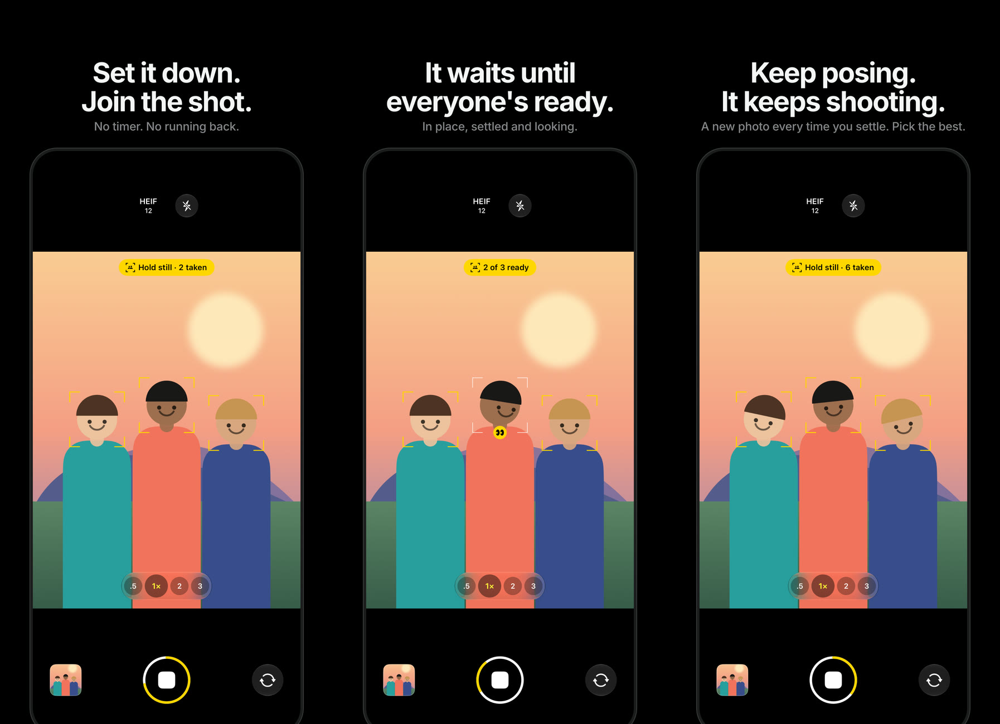
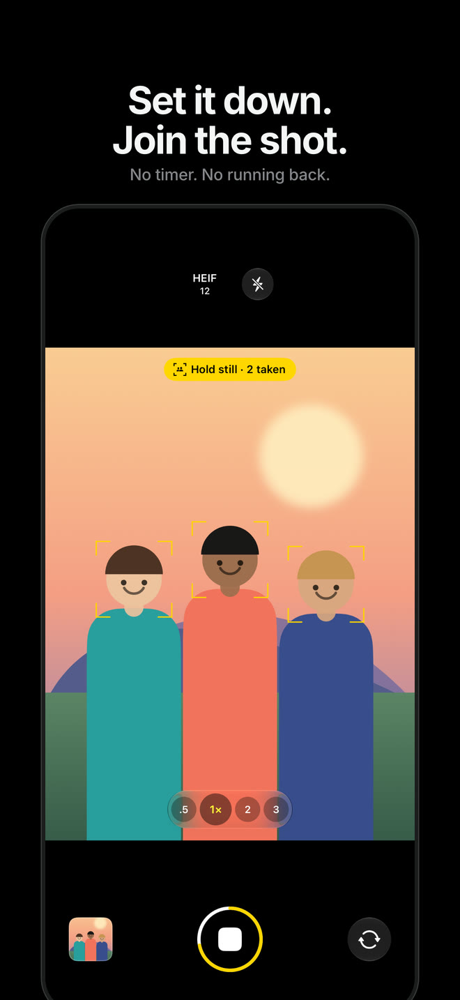
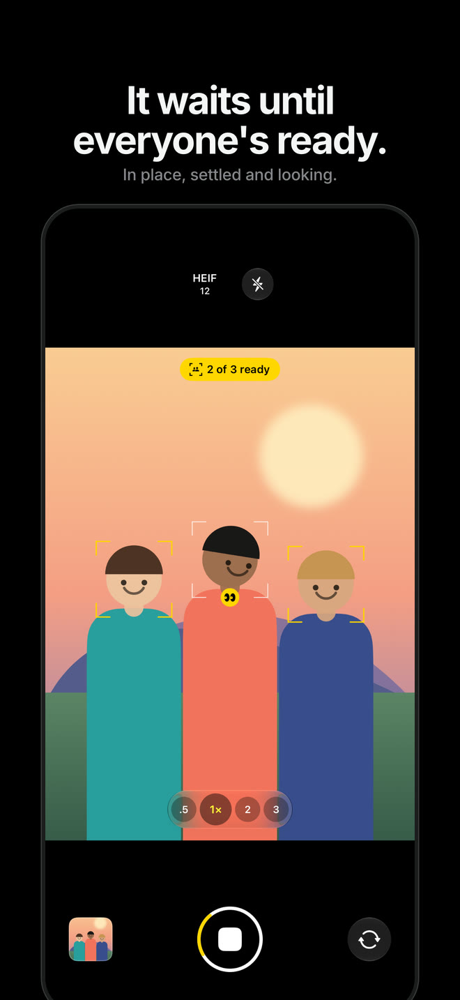

<p align="center">
  
</p>

<h1 align="center">SmartShot</h1>

<p align="center">
  <b>Set it down. Join the shot.</b><br>
  No timer, no running back. Prop up your iPhone, iPad or Mac, press once and walk into the group.<br>
  SmartShot takes the photo when everyone is in place, settled and looking, then keeps shooting while you pose.
</p>

<p align="center">
  <a href="https://apps.apple.com/app/id6822031619"></a>
</p>

<p align="center">
  <b>iPhone Duo's Smart Take, on every iPhone and Mac.</b><br>
  Apple introduced Smart Take on iPhone Duo: a camera for group photos and self-timed shots that needs no timer,<br>
  snaps when everyone is in position, settled and ready, and keeps capturing while you re-pose.<br>
  SmartShot brings that same experience to every iPhone and iPad running iOS 17 or later, and to the Mac.
</p>

<p align="center">
  
  
  
  
  
</p>

<p align="center">
  <a href="https://harkhowalia-1.github.io/SmartShot/"><b>Website</b></a> ·
  <a href="#how-it-works">How it works</a> ·
  <a href="#how-it-decides">How it decides</a> ·
  <a href="#download">Download</a> ·
  <a href="#build-from-source">Build from source</a>
</p>

<br>

<p align="center">
  
</p>

<br>

## How it works

<table>
  <tr>
    <td width="33%" valign="top">
      
      <h3>1. Set it down</h3>
      Prop up your phone, tablet or Mac and press the shutter once. There's no countdown to set and nobody has to sprint back to the group. With the back camera, it waits for you to step into the shot.
    </td>
    <td width="33%" valign="top">
      
      <h3>2. It waits until everyone's ready</h3>
      SmartShot watches every face. When everyone is in place, settled and looking at the camera, the brackets turn yellow and it takes the photo, on a frame where nobody is mid-blink.
    </td>
    <td width="33%" valign="top">
      
      <h3>3. Keep posing</h3>
      It doesn't stop at one. Change your pose, settle again and it takes another, as many as you like, until you press stop. Then pick your favourite.
    </td>
  </tr>
</table>

## Features

**Camera**
- HEIF or Apple ProRAW at 12, 24 or 48 MP, as your device allows. 48 MP uses the main camera and switches lenses for .5× and telephoto automatically.
- A clean, familiar interface with Liquid Glass controls (iOS 26 and later; a material look on earlier versions).
- Zoom buttons and pinch to zoom, tap to focus and expose, flash, front and back cameras.
- With the back camera, the flash light blinks after every automatic photo, so the group knows it was taken (like Smart Take on iPhone Duo).
- Icons turn with your phone; the camera recovers cleanly from calls, FaceTime and Split View.
- On Mac: any built-in, external or iPhone camera. Press Space to start.

**Photos**
- Opens from the thumbnail with a zoom transition; swipe down to close.
- Smooth paging and zoom: pinch, double-tap, momentum and bounce.
- Scrubber, favourites, share the original file, hide and delete.
- Info panel with camera, lens, resolution, file size and exposure.
- Editor with exposure, contrast, saturation, warmth, crop, straighten, rotate and flip. Edits are saved non-destructively and can be reverted any time.

## How it decides

SmartShot follows every person in the frame and checks, about 15 times a second:

| | |
|---|---|
| **Facing the camera** | Head turned less than about 20° |
| **Holding still** | No movement or change in size over the last half second |
| **Eyes open** | Compared with that person's own normal, so narrow eyes aren't mistaken for closed ones |

The group is ready once nobody new has joined for a second and everyone has been ready for 0.7 s. The photo is taken on the next frame where nobody is blinking. After each photo it waits for a new moment (someone moves or changes pose) before taking the next.

## Download

SmartShot is **free on the App Store** for iPhone, iPad and Mac (one purchase, all devices):

<a href="https://apps.apple.com/app/id6822031619"></a>

Prefer to install directly? Every [**release**](../../releases/latest) also includes:

| | | |
|---|---|---|
| **Mac** | [`SmartShot-macOS.dmg`](https://github.com/harkhowalia-1/SmartShot/releases/latest/download/SmartShot-macOS.dmg) | Signed and notarized by Apple. Open it and drag SmartShot onto Applications. |
| **iPhone & iPad** | [`SmartShot-iOS.ipa`](https://github.com/harkhowalia-1/SmartShot/releases/latest/download/SmartShot-iOS.ipa) | For sideloading with [AltStore](https://altstore.io) or [Sideloadly](https://sideloadly.io). Most people should use the App Store. |

## Build from source

Requires Xcode 26 or later and [XcodeGen](https://github.com/yonaskolb/XcodeGen) (`brew install xcodegen`).

```sh
git clone https://github.com/harkhowalia-1/SmartShot.git
cd SmartShot
echo "DEVELOPMENT_TEAM = YOURTEAMID" > Config/Local.xcconfig   # to run on your own device
xcodegen generate
open SmartShot.xcodeproj
```

Choose the **SmartShot-iOS** or **SmartShot-macOS** scheme and run.

```
Shared/
├── App/          App entry point
├── Camera/       Capture, formats and resolutions, saving to Photos
├── SmartShot/    The readiness detector
├── Views/        Camera screen, shutter, zoom, Format panel
├── Viewer/       Photos viewer, Info and editor
└── AppIcon.icon  Layered icon with light and dark variants
```

## Privacy

Face analysis runs on your device using Apple's Vision framework. Camera frames are never stored or sent anywhere, and photos are saved only to your own Photos library.


## Support

If you enjoy this project, you can support me here:

<a href="https://buymeacoffee.com/harkhowalia"></a>

---

<sub>SmartShot is an independent project and is not affiliated with, endorsed by or sponsored by Apple Inc. iPhone, iPhone Duo, iPad, Mac, macOS and App Store are trademarks of Apple Inc. Smart Take is a feature of Apple's iPhone Duo; SmartShot is an independent app inspired by it.</sub>

<sub>Copyright © 2026 Harkhowalia. All rights reserved.</sub>
