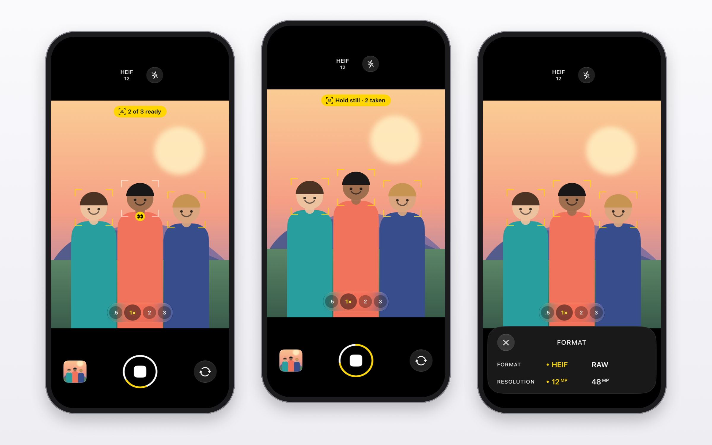
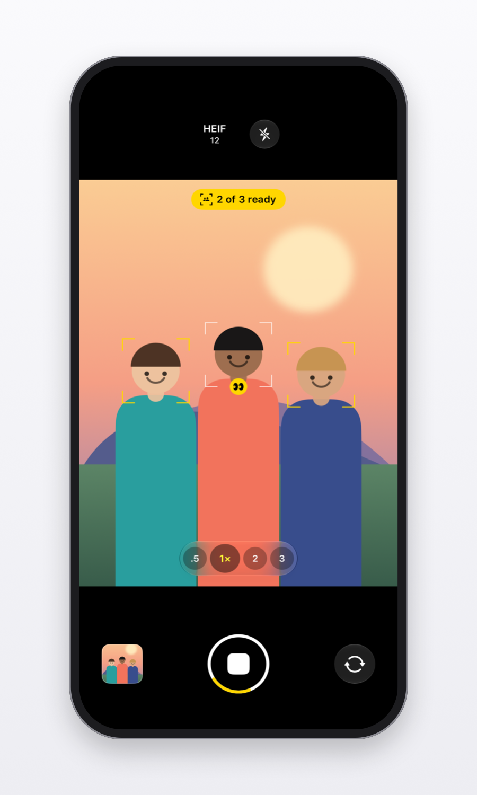
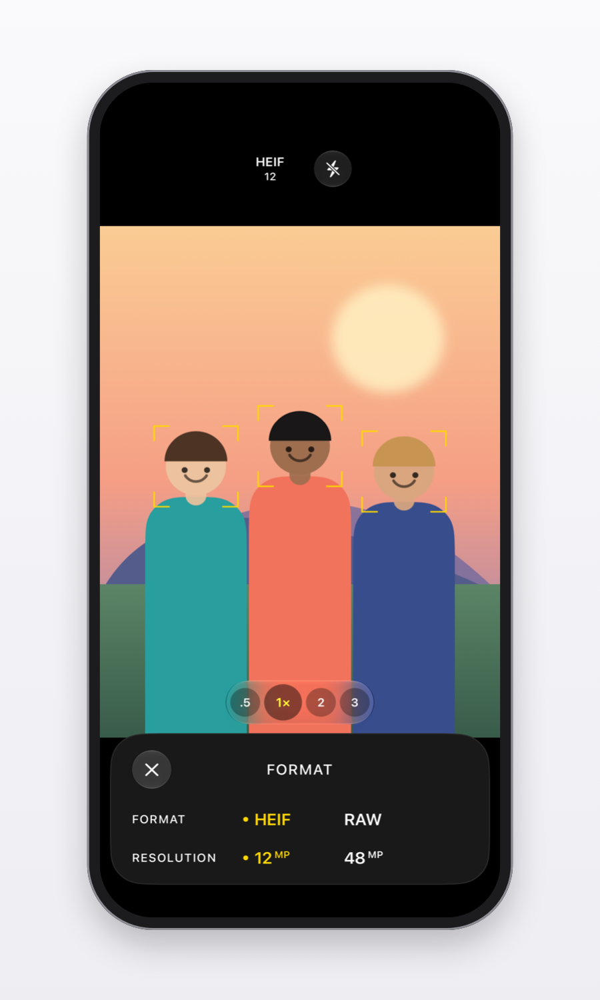

<p align="center">
  
</p>

<h1 align="center">SmartShot</h1>

<p align="center">
  <b>The camera that waits for everyone.</b><br>
  SmartShot watches the group and takes the photo the moment everyone is facing the camera,<br>
  holding still and not blinking. No self-timer race. You're in the photo too.
</p>

<p align="center">
  
  
  
  
  
</p>

<p align="center">
  <a href="https://harkhowalia-1.github.io/SmartShot/"><b>Website</b></a> ·
  <a href="#features">Features</a> ·
  <a href="#how-it-decides">How it decides</a> ·
  <a href="#download">Download</a> ·
  <a href="#build-from-source">Build from source</a>
</p>

<br>

<p align="center">
  
</p>

<br>

<table>
  <tr>
    <td width="25%" valign="top">
      <h3>👥 Everyone, ready</h3>
      Faces, gaze, blinks and movement are checked for every person in the frame, many times a second.
    </td>
    <td width="25%" valign="top">
      <h3>🔁 Keeps shooting</h3>
      Press once. A new photo every time the whole group is ready again, until you stop it.
    </td>
    <td width="25%" valign="top">
      <h3>📸 Full quality</h3>
      HEIF or ProRAW, up to 48 MP, with the same processing as the built-in camera.
    </td>
    <td width="25%" valign="top">
      <h3>🔒 Private</h3>
      Everything happens on your device. No account, no cloud, nothing leaves your phone.
    </td>
  </tr>
</table>

<br>

## Features

<table>
  <tr>
    <td width="33%" valign="top">
      
      <h3>Shoots at the right moment</h3>
      When everyone is ready, the brackets turn yellow and the shutter ring fills while the group holds still. The photo is taken on the first frame where nobody is mid-blink.
    </td>
    <td width="33%" valign="top">
      
      <h3>Knows who's not ready</h3>
      Live hints show who's looking away, moving or blinking, and the banner counts how many people are ready. With the back camera it waits for you to step into the shot first.
    </td>
    <td width="33%" valign="top">
      
      <h3>Pro formats, built in</h3>
      HEIF or Apple ProRAW at 12, 24 or 48 MP, as your device allows. 48 MP uses the main camera and switches lenses for .5× and telephoto automatically.
    </td>
  </tr>
</table>

**Camera**
- A clean, familiar interface with Liquid Glass controls (iOS 26 and later; a material look on earlier versions).
- Zoom buttons and pinch to zoom, tap to focus and expose, flash, front and back cameras.
- Icons turn with your phone; the camera recovers cleanly from calls, FaceTime and Split View.
- On Mac: any built-in, external or iPhone camera. Press Space to start.

**Photos**
- Opens from the thumbnail with a zoom transition; swipe down to close.
- Smooth paging and zoom: pinch, double-tap, momentum and bounce.
- Scrubber, favourites, share the original file, hide and delete.
- Info panel with camera, lens, resolution, file size and exposure.
- Editor with exposure, contrast, saturation, warmth, crop, straighten, rotate and flip. Edits are saved non-destructively and can be reverted any time.

## How it decides

SmartShot follows every person in the frame and checks, about 15 times a second:

| | |
|---|---|
| **Facing the camera** | Head turned less than about 20° |
| **Holding still** | No movement or change in size over the last half second |
| **Eyes open** | Compared with that person's own normal, so narrow eyes aren't mistaken for closed ones |

The group is ready once nobody new has joined for a second and everyone has been ready for 0.7 s. The photo is taken on the next frame where nobody is blinking. After each photo it waits for a new moment (someone moves or changes pose) before taking the next.

## Download

Get the latest version from [**Releases**](../../releases/latest).

| | | |
|---|---|---|
| **Mac** | [`SmartShot-macOS.zip`](https://github.com/harkhowalia-1/SmartShot/releases/latest/download/SmartShot-macOS.zip) | Apple silicon and Intel, macOS 14 or later |
| **iPhone & iPad** | [`SmartShot-iOS.ipa`](https://github.com/harkhowalia-1/SmartShot/releases/latest/download/SmartShot-iOS.ipa) | iOS 17 or later, install with [AltStore](https://altstore.io) or [Sideloadly](https://sideloadly.io) |

**Mac:** unzip, move SmartShot to Applications and open it. It's signed and notarized by Apple, so it opens like any other app.

## Build from source

Requires Xcode 26 or later and [XcodeGen](https://github.com/yonaskolb/XcodeGen) (`brew install xcodegen`).

```sh
git clone https://github.com/harkhowalia-1/SmartShot.git
cd SmartShot
echo "DEVELOPMENT_TEAM = YOURTEAMID" > Config/Local.xcconfig   # to run on your own device
xcodegen generate
open SmartShot.xcodeproj
```

Choose the **SmartShot-iOS** or **SmartShot-macOS** scheme and run.

```
Shared/
├── App/          App entry point
├── Camera/       Capture, formats and resolutions, saving to Photos
├── SmartShot/    The readiness detector
├── Views/        Camera screen, shutter, zoom, Format panel
├── Viewer/       Photos viewer, Info and editor
└── AppIcon.icon  Layered icon with light and dark variants
```

## Privacy

Face analysis runs on your device using Apple's Vision framework. Camera frames are never stored or sent anywhere, and photos are saved only to your own Photos library.

---

<sub>SmartShot is an independent project and is not affiliated with, endorsed by or sponsored by Apple Inc. iPhone, iPad, Mac and macOS are trademarks of Apple Inc.</sub>

<sub>Copyright © 2026 Harkhowalia. All rights reserved.</sub>
